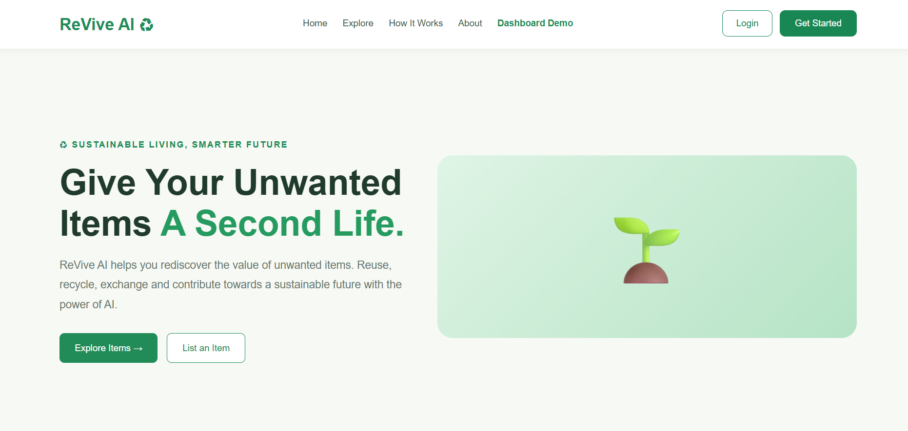
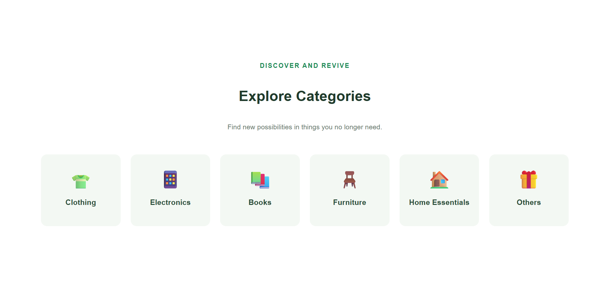
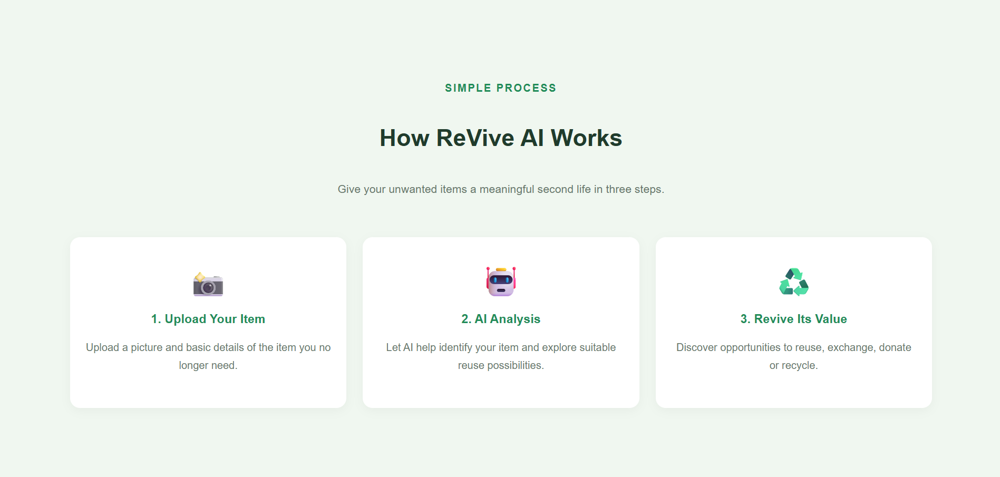
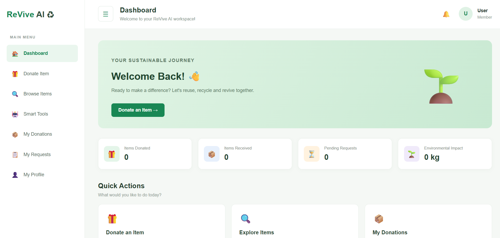
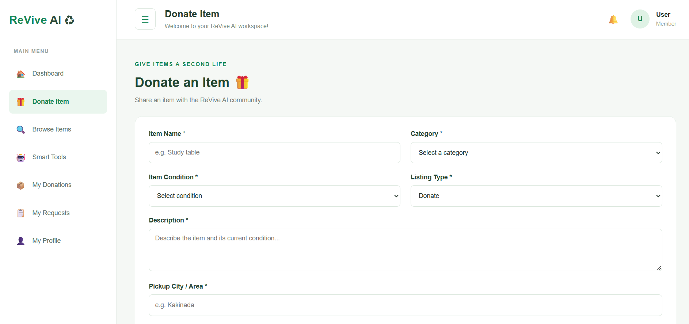

# ReVive AI ♻️

### Give Your Unwanted Items a Second Life

**ReVive AI** is a sustainability-focused web platform that helps people discover better ways to **reuse, repair, donate, exchange, and recycle** unwanted items. It combines an accessible item-listing experience with AI-assisted identification, recommendation services, organization discovery, and environmental impact tracking.

🌐 **Live frontend:** https://revive-ai-round1.vercel.app  
💻 **Source code:** https://github.com/Sri-Hasini/revive-ai  
🏆 **Project stage:** HackWithAditya 2026 — Round 1 prototype

> **Demo note:** The deployed Vercel site hosts the React frontend. Smart Tools API features require the separate FastAPI backend and are **not available on the public website** until that backend is deployed and configured. Login/registration are UI prototypes; item listings are currently saved in the user's own browser.

## The Problem

Usable clothing, electronics, furniture, books, and household items are often discarded because people do not know whether to repair, reuse, donate, or recycle them—or where to find suitable organizations. This contributes to unnecessary waste and missed opportunities to extend product life.

## Our Solution

ReVive AI brings key sustainability actions into one interface:

- **Donate or list items** with category, condition, description, pickup area, and image preview.
- **Browse and filter listings** and track your own demo donations.
- **Get reuse/repair/donation/recycling suggestions** using a rule-based recommendation API.
- **Identify items from images** through an optional Gemini-powered backend service (requires a configured API key).
- **Search for nearby organizations** through an external location-data service (requires network availability).
- **Track recovery activity and environmental impact** using the local demo backend.

## Features and Current Status

| Module | Round 1 status |
|---|---|
| Responsive landing page, categories and process overview | Working frontend |
| Login and registration forms | UI + basic validation; no real authentication yet |
| User dashboard and collapsible sidebar | Working frontend |
| Donate Item form and image preview | Working browser demo |
| Browse Items / My Donations | Browser-local demo storage |
| Smart recommendations | FastAPI endpoint; tested locally |
| Recovery transactions and impact summary | FastAPI + local SQLite demo |
| Gemini image identification | Backend integration; requires API key and internet |
| Organization locator | Backend integration; depends on OpenStreetMap/Overpass availability |
| Shared item database, user accounts, and full marketplace | Future work |

## Technology Stack

| Layer | Technologies |
|---|---|
| Frontend | React, Vite, JavaScript, HTML, CSS |
| Backend | Python, FastAPI, Uvicorn |
| AI and recommendations | Google Gemini API (optional), rule-based recommendation engine |
| Maps and organizations | OpenStreetMap / Overpass API |
| Local impact tracking | SQLite |
| Frontend demo listings | Browser `localStorage` |
| Deployment | Vercel (frontend) |

## Project Structure

```text
revive-ai/
├── frontend/                 # React + Vite application
│   └── src/
│       └── pages/            # Home, Login, Register, Dashboard, Donate, Smart Tools
├── backend/                  # FastAPI application and supporting services
│   ├── main.py
│   ├── routes/
│   ├── services/
│   └── requirements.txt
├── screenshots/              # README screenshots
├── .env.example              # Example backend configuration
└── README.md
```

## Run Locally

**Prerequisites:** Node.js and Python installed.

**1. Start the backend (PowerShell, from the repository root):**

```powershell
py -m venv .venv
.\.venv\Scripts\python.exe -m pip install -r backend\requirements.txt
if (!(Test-Path .env)) { Copy-Item .env.example .env }
.\.venv\Scripts\python.exe -m uvicorn backend.main:app --reload --host 127.0.0.1 --port 8000
```

Backend API docs: http://127.0.0.1:8000/docs

**2. Start the frontend (in a second terminal):**

```powershell
cd frontend
npm install
npm run dev
```

Open the local URL shown by Vite (usually http://localhost:5173).

**3. Explore the prototype:**

Open **Dashboard Demo** from the homepage. Try **Donate Item**, **Browse Items**, **My Donations**, and **Smart Tools**. Recommendations and tracking require the local FastAPI server to remain running.

### Optional Gemini Setup

Add a valid `GEMINI_API_KEY` to the **root `.env`** file to enable image identification. Never commit `.env` or publish an API key. The Gemini service also requires internet access and account/API quota.

## Screenshots

### 1. Homepage



### 2. Explore Categories



### 3. How ReVive AI Works



### 4. User Dashboard



### 5. Donate an Item



## Next Steps

- Connect authentication to persistent user accounts.
- Store listings and uploaded images in a shared backend/database.
- Deploy and secure the FastAPI backend, then connect the public Vercel frontend to it.
- Improve AI-based item condition analysis and personalized recommendations.
- Complete item requests, profiles, and notifications.

## Project Goal

**Reuse more. Waste less. Revive the future.** 🌱
